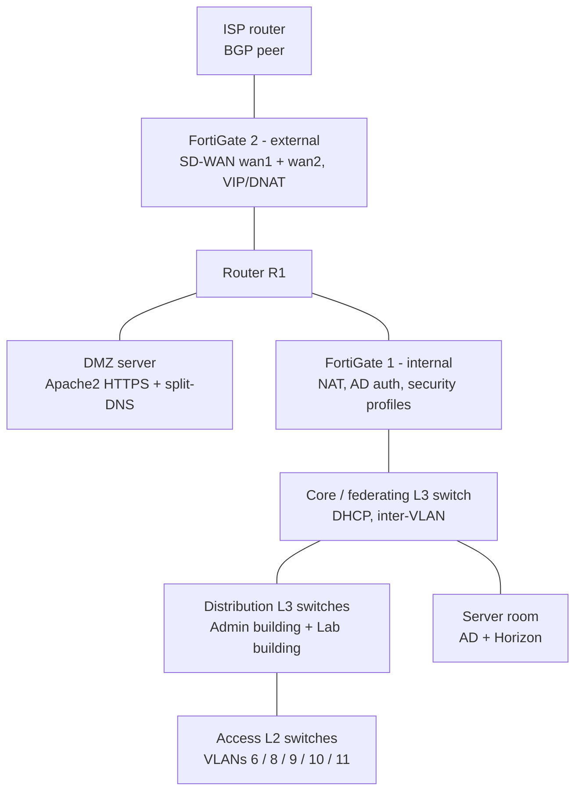

# FortiGate Network Security & VMware Horizon VDI Lab

A secured campus network with **two FortiGate firewalls**, **BGP + SD-WAN** towards a simulated ISP, a **DMZ** with HTTPS and split DNS, **Active Directory authentication** for Internet access, layered **security profiles**, and a **VMware Horizon 8** virtual desktop / published-application platform.

> Internship project — ENSA Fès IT department, Professional Bachelor in Cybersecurity & Cloud Technologies (EST Sidi Bennour, 2024–2025). The network is a **GNS3 simulation** modelled on the school's structure; Horizon runs on a VMware ESXi 7 environment.

## Objectives

1. Design a segmented, resilient and secured campus network
2. Enforce security at L2 (VLANs, port security, DHCP snooping, STP protections) and at the perimeter (FortiGate NGFW)
3. Integrate identity (Active Directory) into firewall policy
4. Deliver centralized, secure access to applications with VMware Horizon

## Architecture



*Simplified view — the full GNS3 topology figure goes in [`screenshots/`](screenshots/).*

## Layer 2 hardening

| Control | Purpose |
|---|---|
| VLANs 6 (students), 8 (professors), 9 (logistics), 10 (IT), 11 (HR) | Segmentation by service and user type |
| 802.1Q trunks + EtherChannel | Inter-switch transport, bandwidth and redundancy |
| Port security | Limit MAC addresses per port (anti-spoofing) |
| DHCP snooping | Block rogue DHCP servers |
| Rapid-PVST + PortFast + BPDU Guard | Fast convergence and protection against BPDU injection on access ports |

## FortiGate

### Foundations
- FortiGate-VM imported from FortiCloud, initial CLI configuration, evaluation licence ([`configs/fortigate/initial-interface.txt`](configs/fortigate/initial-interface.txt))
- Role-based **administrator accounts** (super-admin, read-only, custom profiles) following least privilege
- **Static routing** between L3 switches, FortiGate 1, R1 and FortiGate 2; **BGP** between FortiGate 2 and the ISP routers
- **SD-WAN** on FortiGate 2: two WAN members with SLA probing (latency, loss, jitter) and automatic failover tested by cutting links

### DMZ
- Apache2 web server with **self-signed HTTPS** (OpenSSL)
- **Split DNS**: internal view (full records) and external view (web server only)
- **VIP / DNAT** `dmz_nat` publishing the web server on the WAN side, ports 80/443 only

### Firewall policies
| Firewall | Policy | Action |
|---|---|---|
| Internal | LAN → Internet (source NAT) | Accept |
| Internal | WAN → LAN | **Deny** |
| External | Internet → DMZ via VIP (HTTP, HTTPS) | Accept (DNAT) |
| External | DMZ → Internet (DNS, HTTP, HTTPS, limited) | Accept (NAT) |
| External | Internet → LAN | **Deny** |

### Identity-based access
LDAP connector and AD external connector to a Windows Server domain controller, FortiGate user groups mapped to AD groups, and a LAN → WAN policy that requires authentication. Tests: an authorized user reached allowed sites while a blocked site was denied; a non-authorized user had no Internet access.

### Security profiles
| Profile | Configuration |
|---|---|
| **SSL/SSH inspection** | Custom *Deep Inspection* with CA re-signing (HTTPS, FTPS, SSH) |
| **IPS** | Internal: prevention mode on critical / high / medium signatures. External: monitor mode on HTTP, HTTPS, DNS, FTP, ICMP |
| **Web filter** (`my-web-filter`, proxy-based) | Streaming blocked, telephony monitored, remote access warning, custom Allow / Deny categories, web-rating overrides, static URL exemption |
| **Application control** (`myAppcontrol`) | Category rules, application and filter overrides (risk, popularity, bandwidth), **network protocol enforcement** (HTTP 80, HTTPS 443, FTP 21, DNS 53) |
| **Traffic shaping** | Shared shaper limiting YouTube to 521 Kbps |
| **Antivirus** (`myantivirus`) | Block mode on HTTP, SMTP, POP3, IMAP, FTP |

**Antivirus validation:** malware test files from the WICAR test site were blocked over HTTP, and over HTTPS thanks to deep inspection; the events appear in the antivirus logs.

> **Known limitation:** the FortiGate-VM evaluation licence does not enable every FortiGuard-backed feature. In the lab the web filter could not be fully validated (it blocked everything without a valid licence) and FortiSandbox was not available. The goal of that phase was to learn to build and chain the profiles into policies.

## VMware Horizon 8

| Server | Role |
|---|---|
| Windows Server 2019 — AD DS + DNS | Domain controller, users and groups (students, professors), service accounts for Horizon installation |
| Windows Server 2019 — Horizon **Connection Server** | *Standard Server* install with HTML Access, linked to AD, web admin console |
| Windows Server 2019 — Horizon **Agent** in **RDS mode** | Hosts published applications (Office suite and others), USB redirection enabled, registered to the Connection Server |

An **RDS farm** was created and applications published through the Horizon console.

**Results:** access from PC and tablet clients, AD policies enforced (account lockout), latency under 30 ms.

| Problem | Fix |
|---|---|
| High latency with redirected USB devices | Tuned Horizon Agent settings to prioritize USB traffic |
| Some VMs failing to join the desktop pool | Checked DHCP / DNS rules and Active Directory permissions |

## Repository structure

```
configs/fortigate/   initial CLI configuration and policy summary
docs/                policy tables, profile design, Horizon deployment notes
screenshots/         topology, policies, profiles, Horizon console
```

## What I learned

- Combining perimeter security, L2 controls and identity into one coherent design
- Reading firewall policy order, NAT and VIP behaviour end to end
- The difference between flow-based and proxy-based inspection, and why deep inspection needs a trusted CA on clients
- Real-world constraints: licensing limits, protocol support, troubleshooting VDI latency

## Author

El Mehdi Boussalem — supervised by Mr Zakariae Maach (ENSA Fès) and Mme Zineb El Rhoubari (EST Sidi Bennour).

## Disclaimer

Educational lab. Domain names, IP addresses and accounts have been generalized; passwords are not included.
